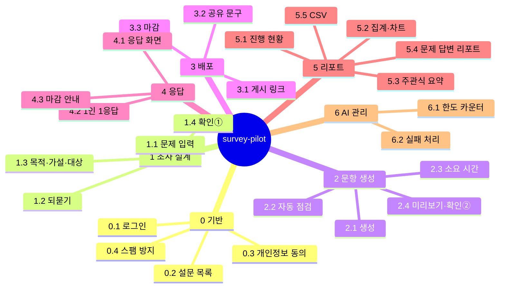

# survey-pilot PRD

문제 정의 하나만 넣으면 설문 설계부터 리포트까지 대신 챙겨 주는 개인용 설문 자동화 웹페이지. 목표 기간 4일.

## 개요

사용자는 **풀고 싶은 문제 하나만** 입력한다(예: "우리 스터디 모임 출석률이 왜 떨어질까"). 서비스가 조사 목적과 가설을 세우고, 대상과 필요한 응답 수를 정하고, 편향 없는 문항을 만든다. 배포 문구를 쓰고 응답을 모은 뒤, **처음 입력한 문제에 대한 답**을 리포트로 돌려준다. 사람은 중간에 두 번 확인만 한다.

## 문제와 해결 방안

- 문제: 설문을 잘 하려면 목적·대상·문항 편향·길이·분석까지 신경 쓸 것이 많다. 그래서 매번 처음부터 쓰고, 응답을 옮겨 정리하고, 주관식을 하나씩 읽게 된다.
- 해결: 신경 써야 할 부분을 서비스가 대신 맡는다.

| 사람이 보통 고민하는 것 | 서비스가 하는 일 |
|---|---|
| 뭘 물어야 하지? | 문제 → 조사 목적 + 검증할 가설 2\~4개 |
| 누구한테 몇 명? | 대상 응답자 정의, 권장 응답 수 제안 |
| 문항을 어떻게 쓰지? | 가설별 문항 생성, 유형(단일·복수·척도·주관식) 자동 선택 |
| 유도 질문이나 한 문항에 두 가지를 묻지 않았나? | 문항 자동 점검(편향·이중 질문·선택지 빠짐·겹침), 고친 안 제시 |
| 너무 길지 않나? | 문제에 맞는 목표 소요 시간 제안, 넘으면 문항 줄이기 |
| 배포 문구는? | 소개글·공유 메시지 자동 작성 + 링크 |
| 정리·분석은? | 자동 집계·차트, 주관식 주제 묶기 |
| 그래서 결론은? | 가설별 지지/기각 + 문제에 대한 답 + 다음 행동 리포트 |

## 타깃 사용자와 사용 시나리오

- 사용자: 나 혼자(관리자 1명) — 2026-10-30부터 여러 사용자(결정 2 참고). 응답자는 링크를 받은 누구나(이메일 입력).

1. 문제 정의 입력 → 모호하면 AI가 최대 3개 되묻기 → 목적·가설·대상 제안 → **확인 ①**
2. 문항 자동 생성 + 자동 점검 → 미리보기에서 필요하면 수정 → **확인 ②** 후 게시
3. 배포 문구와 링크를 복사해 공유 → 응답자는 개인정보 안내에 동의하고 이메일 인증번호를 확인한 뒤 응답
4. 진행 화면에서 응답 수 / 목표 응답 수 확인
5. 목표 응답 수나 마감일 중 먼저 오는 쪽에 자동 마감 → 문제 답변 리포트 + CSV

## 성공 지표

- 완료 기준(배포된 데모): Vercel 주소에서 **문제 입력 → 게시 → 응답 → 리포트** 흐름이 동작한다.
- 문제 입력부터 게시까지 사람이 하는 일: 입력 1번 + 확인 2번(되묻기 답 제외).
- 건수 검증: 응답 N건 제출 → DB N건 → 리포트·CSV N건(ADR 0003, 샘플 20\~30건).

## 위험 요소

- 품질이 AI 출력에 달려 있다 → ADR 0003에 따라 실제 문제 정의 20\~30개로 프롬프트를 먼저 검증한 뒤 화면을 만든다.
- Gemini 무료 한도가 불확실하다(조사 출처마다 하루 20\~1,500회). 설문 하나에 약 4\~6회 호출. 한도는 환경변수로 두고 기본값을 보수적으로(분당 5회, 하루 20회) 잡는다. 실제 값은 AI Studio에서 확인한다.
- 응답 수가 적은데 결론을 단정하는 리포트 → 응답 수가 권장보다 적으면 "참고용"으로 표시한다.
- 응답자 이메일은 개인정보 → 동의를 받고, 마감 30일 후 원문을 지운다.
- 공개 링크 남용 → 제출·인증번호 요청 횟수 제한 + 숨은 칸(honeypot).
- 인증번호 메일(Gmail SMTP)의 하루 한도가 하루 응답 수의 상한이 된다 → `MAIL_DAILY_LIMIT`(기본 100, 보수적으로)을 코드에서 센다. Gmail 실제 한도(약 500통/일로 알려짐)는 확인하지 않았다.

## 범위

- 이번 버전 포함: 아래 기능 트리 전체.
- 제외: 팀·여러 사용자, 조건 분기, 안내·리마인드 메일(인증번호 메일만 포함), 패널 모집, 파일 업로드 문항, 다국어, 유료 AI.

## 기능 트리

- **0. 기반 기능**: 0.1 관리자 로그인(허용한 이메일 1개) · 0.2 내 설문 목록 · 0.3 응답자 개인정보 안내·동의 · 0.4 응답 스팸 방지 · 0.5 설문 보관함(삭제 대신 숨기기·복원)
- **1. 문제 정의 → 조사 설계**: 1.1 문제 정의 입력 · 1.2 모호하면 되묻기(최대 3개) · 1.3 목적·가설·대상·권장 응답 수·목표 소요 시간·마감일 제안 · 1.4 설계 확인 ①
- **2. 문항 자동 생성**: 2.1 가설별 문항 생성·유형 자동 선택 · 2.2 문항 자동 점검 · 2.3 소요 시간 계산·문항 줄이기 · 2.4 미리보기·수정(확인 ②)
- **3. 배포**: 3.1 게시 링크 · 3.2 소개글·공유 메시지 · 3.3 자동 마감 + 수동 마감
- **4. 응답(응답자용)**: 4.1 응답 화면(Tally 스타일) · 4.2 이메일 인증번호·1인 1응답·필수 문항 검사 · 4.3 마감·없는 설문 안내
- **5. 결과·리포트**: 5.1 진행 현황 · 5.2 문항별 집계·차트 · 5.3 주관식 요약 · 5.4 문제 답변 리포트 · 5.5 CSV 내보내기
- **6. AI 사용 관리**: 6.1 호출 한도 카운터 · 6.2 한도 초과·실패 처리 · 6.3 메일 발송 한도

## 결정 사항 (2026-10-29)

지식베이스에서 가져온 것
- 비용 0원: 유료 API를 기본값으로 쓰지 않는다(ADR 0002).
- 샘플 먼저: AI 파이프라인은 내 데이터 20\~30개로 먼저 검증한다(ADR 0003).

사용자에게 물어 정한 것
1. 핵심 가치: 문제 정의 하나로 설문 만들기·배포·응답 수집·결과 분석까지 자동화.
2. 사용자: 나 혼자(개인 도구). → 2026-10-30 누구나 가입하는 여러 사용자로 바뀜([여러 사용자 spec](2026-10-30-multi-user.md), ADR 0020).
3. 기술 스택: Next.js + Supabase + Vercel(무료 티어).
4. 완료 기준: 배포된 데모에서 전체 흐름이 동작.
5. AI: Gemini API 무료 티어.
6. 응답자: 이메일 입력 필수, 1인 1응답.
7. 문항 유형: 객관식(단일)·객관식(복수)·척도(1\~5)·주관식.
8. 화면 레퍼런스: Tally.
9. 사람 개입: 확인 2번(설계 확인, 게시 전 미리보기).
10. 문제 정의가 모호하면: AI가 빠진 것만 객관식으로 최대 3개 되묻기.
11. 마감: 목표 응답 수 또는 마감일 중 먼저 오는 쪽에 자동 마감 + 수동 마감.
12. 기반 기능: 관리자 로그인, 내 설문 목록, 개인정보 안내·동의, 스팸 방지 모두 포함.
13. 이메일 보관: 마감 30일 후 원문 삭제, 중복 확인용 해시만 남김.
14. 게시 후 수정: 응답 0건일 때만 문항 수정. 응답이 있으면 소개글·마감일·목표 응답 수만.
15. 리포트 시점: 집계·차트는 실시간, AI 리포트는 마감 때 자동 + 중간 리포트 버튼.
16. 목표 소요 시간: 문제에 따라 AI가 제안(1.3 설계 단계).
17. 응답자 이메일 확인: 인증번호 메일로 확인. 발송은 Gmail SMTP(앱 비밀번호). 응답자는 Supabase 로그인 사용자로 만들지 않고 인증번호를 직접 해시로 저장.
18. 인증번호: 6자리, 10분 유효, 5번 틀리면 무효, 재발송 60초 간격.
19. 문항 생성과 자동 점검: AI를 따로 2번 호출(품질 우선). 설문 하나에 약 4회.
20. 설문 삭제: 지우지 않고 보관함으로 숨김(복원 가능). 진행 중이면 먼저 마감. (보관 시 마감은 Claude가 정한 규칙)
21. CSV: 응답자 이메일을 넣지 않음.

## 사람 손이 필요한 일

| 할 일 | 그동안 할 수 있는 것 |
|---|---|
| Supabase 프로젝트 생성(무료), 키를 `.env.local`에 | 스키마·RLS SQL, 화면 |
| Google AI Studio에서 Gemini 키 발급 + 내 프로젝트의 실제 분당·하루 한도 확인 | AI 없이 동작하는 경로 먼저 |
| Vercel 가입·GitHub 연결·환경변수 등록 | 로컬 E2E |
| 발송용 Gmail 계정에 2단계 인증 켜고 앱 비밀번호 발급, `.env.local`에 | 메일 발송을 가짜(mock)로 두고 흐름 구현 |

비밀값은 채팅에 붙여넣지 않고 `.env.local`에만 둔다.

## 다음 단계

기능별 상세(권한·규칙·데이터·예외·확인 방법) → 데이터 모델 → 자체 점검 → 기능명세서(spec)·구현 순서(plan).
