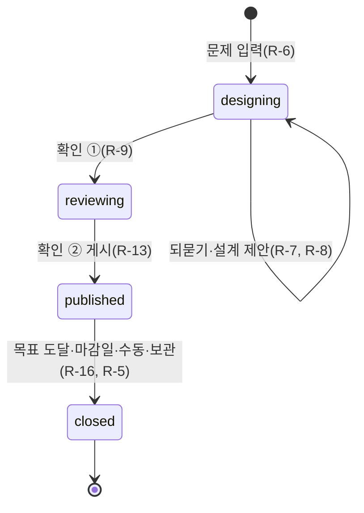
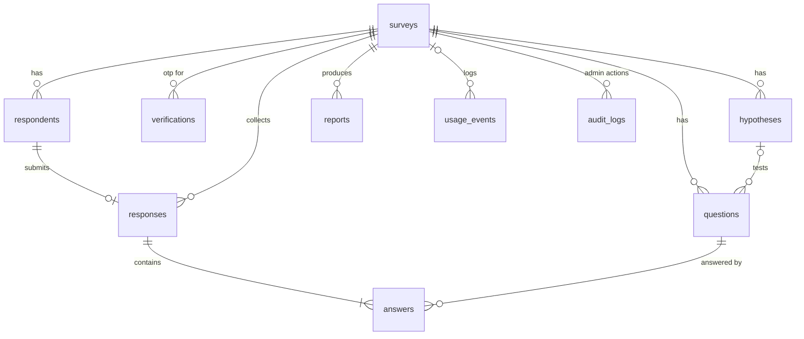

# 서베이 파일럿 설계

> 2026-10-30부터 여러 사용자 서비스로 바뀐다 — R-1·R-2·R-3·R-26·R-27·R-29·R-31은 [여러 사용자 spec](2026-10-30-multi-user.md)이 바꾼 대로 읽는다(ADR 0020).

## 배경

설문을 잘 하려면 목적·가설·대상·문항 편향·길이·분석까지 신경 쓸 것이 많다. 사용자 말: "이 서비스의 핵심은 설문조사를 위해 신경써야 할 부분을 대부분 덜어줘야 돼. 처음 사용자에게 설문하고 싶은 문제 정의를 받아서 대부분 자동화로 해 주는 거지." 배경·시나리오·성공 지표는 [PRD](2026-10-29-survey-pilot-prd.md).

## 목표 / 하지 않을 것

- 목표: 관리자(나 1명)가 문제 정의 하나를 입력하고 확인 2번만 하면, 설문이 게시되고 응답이 모이고 문제에 대한 답 리포트가 나온다. 배포된 Vercel 주소에서 이 흐름이 동작한다(완료 기준, 4일).
- 하지 않을 것: 팀·여러 관리자, 조건 분기, 안내·리마인드 메일(인증번호 메일만 보냄), 패널 모집, 파일 업로드 문항, 다국어, 유료 AI, 설문 완전 삭제.

## 요구사항

시간은 모두 KST로 보여 주고 UTC(`timestamptz`)로 저장한다. 서비스 표시 이름 "서베이 파일럿"은 상수 하나에 둔다.

### 0. 기반 기능

- **R-1** 0.1 관리자 로그인 — 매직링크로 로그인한 이메일이 `ADMIN_EMAIL`과 다르면, 서비스는 관리자 화면 접근을 거부한다.
  - 권한: `ADMIN_EMAIL` 1명. 그 밖의 계정은 로그인돼도 관리자 화면·API가 403. DB도 `admins` 테이블(서버가 `ADMIN_EMAIL`로 채움)에 있는 이메일만 관리자로 본다 — Supabase는 공개 키로 누구나 가입할 수 있으므로.
  - 예외: 링크 만료 → "링크가 만료됐어요. 다시 받아 주세요".
  - 확인: 다른 이메일 세션으로 관리자 API 호출 시 403 테스트.
- **R-2** 0.2 내 설문 목록 — 관리자가 목록을 열면, 서비스는 진행 중·만드는 중(설계·검토)·마감 묶음별로 최신순 설문을 보여 주고, 보관함은 접어서 보여 준다(결정 27).
  - 화면: 맨 위에 문제 입력 칸. 비었을 때 "아직 설문이 없어요. 위에 첫 문제를 적어 보세요." 카드에 문제·응답 수/목표·단계 진행.
  - 확인: 묶음별 개수가 DB 건수와 같다.
- **R-3** 0.3 응답자 개인정보 안내·동의 — 응답자가 동의하지 않으면, 서비스는 인증번호 발송(또는 바로 응답 시작)과 제출을 거부한다. v7: 설문마다 응답 방식 — 기본은 이메일 없이 바로 응답(동의만, 같은 브라우저는 한 번만), 설문 주인이 "한 사람 한 번만 받기"를 켜면 이메일 인증(ADR 0017 v2). 바로 응답 안내에는 "이메일을 받지 않아 낸 응답을 찾아 지울 수 없어요".
  - 안내 문구: 수집 항목(이메일), 목적(1인 1응답 확인), 보관(마감 30일 후 원문 삭제), "응답은 분석을 위해 Google Gemini로 처리됩니다", 주관식에 개인정보를 적지 말라는 안내, 삭제 요청 연락처(`CONTACT_EMAIL`).
  - 데이터: `respondents.consented_at`.
  - 확인: 동의 없이 발송·제출 API 호출 시 400.
- **R-4** 0.4 응답 스팸 방지 — 숨은 칸(honeypot)에 값이 있으면 서비스는 저장하지 않고 성공처럼 응답한다. 같은 IP에서 1시간에 인증번호 요청 5회·제출 10회를 넘으면 거부한다.
  - 데이터: IP는 `HASH_SECRET`을 섞은 HMAC 해시로만 저장.
  - 화면: "잠시 후 다시 시도해 주세요".
  - 확인: 6번째 발송·11번째 제출 거부 테스트, honeypot 제출 시 DB 0건.
- **R-5** 0.5 설문 보관함 — 관리자가 보관하면, 서비스는 설문을 지우지 않고 보관함 탭으로 옮긴다. 진행 중이면 먼저 마감(`close_reason=archive`)한다. 복원하면 보관 전 상태로 돌아간다(마감된 설문은 마감 상태 그대로).
  - 권한: 관리자. DB에 설문 delete 정책은 두지 않는다.
  - 확인: 진행 중 설문 보관 → `closed` + `archived_at`, 복원 → `archived_at` null·상태 `closed` 유지.

### 1. 문제 정의 → 조사 설계

- **R-6** 1.1 문제 정의 입력 — 관리자가 10~1,000자의 문제를 입력하면, 서비스는 `designing` 상태 설문 1건을 만든다.
  - 예외: 길이 밖 → 입력 칸 아래 안내. 저장 실패 → 입력 내용 유지.
  - 확인: 입력 1번 → `surveys` 1행.
- **R-7** 1.2 모호하면 되묻기 — 문제에 대상·상황·알고 싶은 것 중 빠진 것이 있으면, 서비스는 빠진 것만 객관식(직접 입력 허용)으로 최대 3개 묻는다. 빠진 것이 없으면 묻지 않는다.
  - 데이터: `surveys.clarifications`(질문·답).
  - 확인: 샘플 30개 중 모호하게 만든 문제에서만 질문이 나오는지 사람이 판정(ADR 0003), 질문 수 ≤ 3 스키마 검사.
- **R-8** 1.3 조사 설계 제안 — 문제(와 되묻기 답)가 있으면, 서비스는 AI 1회 호출로 목적 1줄·가설 2~4개·대상·권장 응답 수·목표 소요 시간·소개글·공유 메시지를 만든다. 마감일 기본값은 오늘 + 7일 23:59 KST.
  - 데이터: `surveys`의 해당 칸, `hypotheses`.
  - 확인: 출력이 JSON 스키마 검증 통과, 가설 수 2~4.
- **R-9** 1.4 설계 확인 ① — 관리자가 확인을 누르기 전에는, 서비스는 문항을 만들지 않는다. 관리자는 항목을 고치거나 다시 제안받을 수 있다.
  - 상태: `designing` → 확인 → `reviewing`.
  - 확인: 확인 전 문항 생성 API 호출 시 409.

### 2. 문항 자동 생성

- **R-10** 2.1 가설별 문항 생성 — 설계가 확인되면, 서비스는 AI 1회 호출로 가설마다 문항 1개 이상을 만들고 유형(단일·복수·척도 1~5·주관식)을 고른다. 마지막 문항은 선택 응답 주관식 "더 하고 싶은 말"로 고정한다.
  - 데이터: `questions`(가설 연결 `hypothesis_id`).
  - 확인: 모든 가설에 문항이 1개 이상, 마지막 문항이 고정 주관식.
- **R-11** 2.2 문항 자동 점검 — 문항이 만들어지면, 서비스는 별도 AI 1회 호출로 유도 질문·이중 질문·선택지 빠짐(기타 없음)·겹침(구간 중복)을 찾아 고치고 고친 이유를 `review_note`에 남긴다.
  - 화면: 미리보기에서 문항 아래 작게 "자동으로 고침: …".
  - 확인: 일부러 편향 문항을 넣은 샘플을 점검이 잡아낸다(샘플 검증).
- **R-12** 2.3 소요 시간 맞추기 — 예상 소요 시간(단일 7초·복수 10초·척도 5초·주관식 30초의 합)이 목표를 넘으면, 서비스는 가설 연결이 약한 문항부터 빼서 목표 안으로 맞춘다. 가설마다 최소 1문항은 남긴다.
  - 확인: 소요 시간 계산·줄이기 단위 테스트.
- **R-13** 2.4 미리보기·확인 ② — 관리자가 게시를 누르기 전에는, 서비스는 응답 링크를 열지 않는다. 미리보기는 응답자 화면 그대로이고, 문항 수정·삭제·순서 바꾸기·추가·한 문항 다시 만들기를 할 수 있다.
  - 상태: `reviewing` → 게시 → `published`.
  - 확인: `reviewing` 설문의 공개 링크는 404.

### 3. 배포

- **R-14** 3.1 게시 링크와 수정 제한 — 게시되면 서비스는 추측하기 어려운 `/s/<slug>` 링크를 만든다. 응답이 1건 이상이면 문항·선택지·가설은 수정할 수 없고 소개글·마감일·목표 응답 수만 수정할 수 있다.
  - 확인: 응답 1건 뒤 문항 수정 시도가 DB 트리거로 거부된다.
- **R-15** 3.2 공유 문구 — 게시 화면에서, 서비스는 소개글과 카톡용 공유 메시지(소요 시간·링크 포함)를 복사 버튼과 함께 보여 준다. 관리자는 문구를 고칠 수 있다.
  - 확인: 복사한 메시지에 링크와 소요 시간이 들어 있다.
- **R-16** 3.3 마감 — 응답 수가 목표에 닿거나 마감일이 지나면, 서비스는 둘 중 먼저 오는 쪽에 설문을 마감한다. 관리자는 언제든 수동 마감할 수 있다. 마감되면 최종 리포트 생성을 시작한다.
  - 규칙: 목표 도달은 제출 트랜잭션 안에서 설문 행을 잠그고(`for update`) 세므로 목표보다 많이 받지 않는다. 마감일은 접근할 때마다 확인하고, 하루 1회 크론(KST 00:10)으로도 처리한다.
  - 확인: 목표 3이면 3번째 제출 뒤 `closed`, 남은 자리 1개에 동시 제출 2건 → 1건만 성공.

### 4. 응답

- **R-17** 4.1 응답 화면 — 응답자가 링크를 열면, 서비스는 Tally 스타일 한 페이지에 소개글 → 동의 → 이메일 인증 → 문항 순으로 보여 준다. 모바일 우선.
  - 확인: 실제 브라우저에서 모바일 너비로 끝까지 응답(실제 빠르기로 한 번).
- **R-18** 4.2 이메일 인증번호 — "한 사람 한 번만 받기"를 켠 설문에서 응답자가 이메일을 내면, 서비스는 그 이메일이 이 설문에 이미 응답했는지 먼저 확인한 뒤 6자리 인증번호를 Gmail SMTP로 보낸다. 번호는 10분 유효, 5번 틀리면 무효, 재발송은 60초 간격이다. 인증 후 30분 안에 제출해야 한다.
  - 데이터: `verifications`(번호는 해시로만), 이메일은 소문자·앞뒤 공백 제거 후 HMAC 해시.
  - 예외: 이미 응답 → 메일을 보내지 않고 "이미 응답하셨어요". 메일 실패 → "메일을 보내지 못했어요. 잠시 후 다시 시도해 주세요".
  - 확인: 11분 뒤 번호 거부, 6번째 시도 거부, 59초 안 재발송 거부 테스트(메일은 mock).
- **R-19** 4.2 1인 1응답과 입력 검사 — 응답이 제출되면(이메일 인증 설문은 1인 1응답, 바로 응답 설문은 1브라우저 1응답), 서비스는 인증 토큰·필수 문항·선택지 값(그 문항의 선택지 id인지)·척도 범위를 서버에서 검사하고 응답과 답을 한 트랜잭션으로 저장한다. 같은 설문에 같은 이메일(대소문자만 다름 포함)은 한 번만 받는다.
  - 확인: 대소문자만 다른 이메일로 두 번째 제출 거부, 없는 선택지 id 제출 시 400, 제출 N건 → `responses` N행.
- **R-20** 4.3 마감·없는 설문 안내 — 마감된 설문이면 "마감된 설문이에요", 없거나 게시 전이면 404, 보관된 설문이면 마감 안내를 보여 준다.
  - 확인: 상태별 화면 테스트.

### 5. 결과·리포트

- **R-21** 5.1 진행 현황 — 관리자가 설문을 열면, 서비스는 응답 수 / 목표와 마감까지 남은 시간을 보여 준다.
  - 확인: 응답 수가 `responses` 건수와 같다.
- **R-22** 5.2 문항별 집계·차트 — 서비스는 AI 없이 실시간으로 단일·복수는 선택지별 수와 비율(복수는 응답자 수 기준), 척도는 평균과 1~5 분포를 보여 준다.
  - 확인: 응답 N건 → 단일 문항 선택지 합계 N(건수 검증), 집계 함수 단위 테스트.
- **R-23** 5.3 주관식 요약 — 리포트를 만들 때, 서비스는 주관식 응답을 주제 3~5개로 묶고 주제마다 대표 응답을 원문 그대로 인용한다.
  - 확인: 인용문이 실제 응답 원문에 있는지 문자열 대조 테스트.
- **R-24** 5.4 문제 답변 리포트 — 마감되면 자동으로, 진행 중에는 버튼으로, 서비스는 AI 1회 호출로 가설별 지지/기각/판단 불가와 근거 수치·문제에 대한 답·다음 행동 2~3개를 만든다. 응답 수가 권장보다 적으면 "참고용"으로 표시한다. 같은 응답 수로 만든 리포트가 있으면 다시 호출하지 않는다.
  - 데이터: `reports`(kind `interim`·`final`, `response_count`, `is_tentative`).
  - 확인: 같은 응답 수로 두 번 요청 시 AI 호출 1회, 권장 미만이면 `is_tentative=true`.
- **R-25** 5.5 CSV 내보내기 — 관리자가 내보내면, 서비스는 응답 1건 = 1줄, 열 = 문항인 UTF-8(BOM) CSV를 준다. 응답자 이메일은 넣지 않는다.
  - 확인: 응답 N건 → CSV 데이터 N줄, 이메일 열 없음.
- **R-26** 5.6 응답 삭제 요청 처리 — 관리자가 이메일로 응답을 찾으면, 서비스는 미리보기 → 사유 입력 → 재확인을 거쳐서만 그 응답과 답을 지우고 감사 기록(누가·언제·사유·설문, 이메일은 해시)을 남긴다(ADR 0012). 마감 30일이 지나 원문이 없으면 해시로 찾는다.
  - 확인: 사유 없이 삭제 시 400, 삭제 후 감사 기록 1행·집계 N-1.

### 6. 무료 한도·안전

- **R-27** 6.1 AI 호출 한도 — Gemini를 부르기 전에, 서비스는 최근 1분·24시간 호출 수를 세어 `GEMINI_RPM`·`GEMINI_RPD`(기본 15·500, `gemini-3.5-flash-lite` 무료 한도)를 넘으면 부르지 않는다.
  - 데이터: `usage_events`(kind `ai`).
  - 확인: 한도 2로 두면 3번째 호출이 Gemini를 부르지 않고 `blocked`로 기록된다.
- **R-28** 6.2 AI 실패 처리 — 한도 초과·오류·출력 스키마 실패가 나면, 서비스는 설문 상태와 입력을 그대로 두고 "AI 사용 한도에 도달했어요. 약 n분 뒤 다시 시도해 주세요" 또는 오류 안내와 다시 시도 버튼을 보여 준다. 스키마 실패는 1번만 자동 재시도한다.
  - 확인: Gemini mock이 오류를 내면 상태가 바뀌지 않고, 잘못된 JSON 두 번이면 재시도 1회 뒤 실패 안내.
- **R-29** 6.3 메일 발송 한도 — 인증번호를 보내기 전에, 서비스는 최근 24시간 발송 수가 `MAIL_DAILY_LIMIT`(기본 100)을 넘으면 보내지 않고 "오늘은 응답을 더 받을 수 없어요"를 보여 준다.
  - 확인: 한도 1로 두면 두 번째 발송이 거부된다.
- **R-30** 6.4 이메일 원문 정리 — 매일 크론에서, 서비스는 마감 30일이 지난 설문의 `respondents.email`을 null로 바꾸고(해시는 남김) 만료된 `verifications`를 지운다. 크론은 `CRON_SECRET`이 맞을 때만 실행된다.
  - 확인: 마감 31일 전 설문은 원문 null, 29일 전 설문은 유지. 비밀값 없는 크론 호출 401.
- **R-31** 6.5 응답자는 DB에 직접 접근하지 않음 — anon 키로는, 서비스의 어떤 테이블도 읽거나 쓸 수 없다. 응답자 쪽 읽기·쓰기는 서버 라우트(service role)만 한다. 관리자는 RLS로 자기 설문과 그 하위 행만 읽는다(ADR 0019).
  - 확인: anon 클라이언트로 모든 테이블 select·insert → 0행 또는 거부.
- **R-32** 6.6 프롬프트 주입 막기 — 문제 정의와 주관식 응답을 AI에 넘길 때, 서비스는 구분자로 감싼 데이터로 넘기고 그 안의 지시를 따르지 않게 하며, 출력은 JSON 스키마로 검증한다. 이메일은 AI에 보내지 않는다.
  - 확인: "이전 지시를 무시하고 …"가 든 샘플 응답으로 리포트를 만들어도 스키마를 지키고 해당 지시를 따르지 않는다(샘플 검증).

## 설계

### 스택과 무료 한도 (ADR 0002, 확인 2026-10-29)

| 무엇 | 쓰는 것 | 한도(확인 상태) | 코드에 반영 |
|---|---|---|---|
| 웹·배포 | Next.js + Vercel Hobby | 크론 하루 1회로 알려짐(미확인) | 마감은 접근 시 확인 + 크론 |
| DB·관리자 인증 | Supabase Free | 기본 메일은 시간당 약 2통(출처마다 다름) → 관리자 매직링크에만 사용 | — |
| AI | Gemini API 무료 티어 | 모델별로 다름 — AI Studio 확인(2026-10-30): gemini-3.8-flash 분당 5·하루 20, gemini-3.5-flash-lite 분당 15·하루 500, 무료 입력은 제품 개선에 쓰일 수 있다고 알려짐(약관 원문 미확인) | 기본 모델 `gemini-3.5-flash-lite`, `GEMINI_RPM`·`GEMINI_RPD` 기본 15·500 (R-27) |
| 인증번호 메일 | Gmail SMTP(앱 비밀번호) | 하루 약 500통으로 알려짐(미확인) | `MAIL_DAILY_LIMIT` 기본 100 (R-29) |

설문 하나의 AI 호출: 설계 1 + 생성 1 + 점검 1 + 리포트 1 = 약 4회(다시 만들기 제외).

### 흐름과 상태

상태는 앞으로만 간다. 보관(`archived_at`)은 상태와 따로 둔다.

### 데이터 모델

마이그레이션 SQL이 생기면 컬럼은 그쪽이 기준이다(ADR 0007). 여기에는 관계와 규칙만 둔다.

| 테이블 | 핵심 규칙 |
|---|---|
| admins | 관리자 이메일(소문자), 서버만 접근 |
| surveys | owner = 관리자, 상태 앞으로만, slug 유일, 보관은 `archived_at`, 권장 응답 수 = 목표 응답 수(`target_responses` 한 칸) |
| hypotheses | 설문당 2~4개 |
| questions | (survey, position) 유일, 응답 1건 이상이면 수정·삭제 불가(트리거) |
| verifications | 번호 해시·만료·시도 수·발송 시각, 서버만 접근 |
| respondents | (survey, email_hash) 유일, email 원문은 마감 30일 후 null |
| responses | respondent당 1건, answers와 한 트랜잭션 |
| answers | (response, question) 유일, value는 jsonb(선택지 id 배열·1~5·텍스트) |
| reports | (survey, kind, response_count)로 재사용 |
| usage_events | kind `ai`·`mail`, 최근 1분·24시간 건수로 한도 판단, 서버만 접근 |
| audit_logs | 관리자 데이터 변경(응답 삭제) 기록, 서버만 쓰기 |

### 접근 제어 (Supabase RLS, ADR 0019)

- surveys: `owner_id = auth.uid()` 그리고 JWT 이메일이 `admins`에 있을 때(`is_admin()`) select·insert·update. delete 정책 없음.
- 하위 테이블: 부모 설문의 owner일 때 select만. 쓰기는 service role.
- admins·verifications·usage_events·audit_logs: 정책 없음(서버만). anon에는 테이블 권한 자체를 주지 않는다.

### 환경변수

`NEXT_PUBLIC_SUPABASE_URL`, `NEXT_PUBLIC_SUPABASE_ANON_KEY`, `SUPABASE_SERVICE_ROLE_KEY`, `GEMINI_API_KEY`, `GEMINI_RPM`, `GEMINI_RPD`, `GMAIL_USER`, `GMAIL_APP_PASSWORD`, `MAIL_DAILY_LIMIT`, `ADMIN_EMAIL`, `CONTACT_EMAIL`, `HASH_SECRET`, `CRON_SECRET`. 비밀값은 `.env.local`과 Vercel에만 두고 커밋하지 않는다.

## 검증 방법

- **샘플 먼저(ADR 0003)**: 문제 정의 30개(사용자 실제 10개 + Claude 초안 20개, 모호한 문제·편향 유도 문제 섞음, 사용자 검토)로 설계·생성·점검 프롬프트를 화면보다 먼저 돌린다. 기준: 스키마 통과 30/30, 모호한 문제에서만 되묻기, 편향 문항을 점검이 잡음, 사람 판정 "그대로 쓸 만함" 24/30 이상. 리포트 프롬프트는 가짜 응답 20~30건으로 같은 방식.
- **테스트**: 각 R-ID의 "확인" 줄을 테스트로 만든다. 테스트 이름이나 주석에 `survey-pilot#R-n`을 적는다(ADR 0014). Gemini·Gmail은 mock.
- **건수 검증**: 응답 N건 제출 → `responses` N행 → 집계 합계 N → 리포트 `response_count` N → CSV N줄.
- **완료 기준**: 배포된 Vercel 주소에서 문제 입력 → 확인 ① → 확인 ② → 실제 이메일 인증 응답 3건 이상 → 마감 → 리포트가 동작한다.

## 열린 질문

- 가정 1 — 관리자가 탭 두 개에서 같은 설문을 고치면 마지막 저장을 반영한다(관리자 1명이라).
- 가정 2 — 보관할 때 진행 중이면 먼저 마감한다(Claude가 정한 규칙, 결정 20).
- 가정 3 — 인증 후 제출 제한 30분, 같은 IP 시간당 발송 5회·제출 10회, 유형별 예상 초(7·10·5·30)는 Claude가 정한 기본값이다. 샘플 응답 시간을 보고 조정한다.
- 확인 필요 — Gemini·Gmail·Supabase 메일·Vercel 크론의 실제 한도, Gemini 무료 티어 데이터 사용 약관 원문.

## 결정 사항

[PRD 결정 사항](2026-10-29-survey-pilot-prd.md) 1~21에 더해:
22. 동의 문구에 Gemini 처리 사실을 명시하고, 이메일은 AI에 보내지 않는다(R-3, R-32).
23. 샘플은 사용자 실제 문제 10개 + Claude 초안 20개(사용자 검토).
24. 응답 삭제 요청은 연락처로 받아 관리자가 미리보기 → 사유 → 삭제, 감사 기록(R-26, ADR 0012).
25. 서비스 표시 이름 "서베이 파일럿"(Claude 추천).
26. ADR로 남김: 응답자 개인정보(0017), 무료 한도 관리(0018), 응답자는 서버로만(0019).
27. 관리자 화면 구조는 C 단계형(디자인 1단계, 2026-10-29 사용자 선택): 목록 맨 위에서 바로 문제 입력, 설문마다 단계 진행(문제→설계→문항→응답→리포트), 설계 폼은 묶음별 카드. 이유: "문제 하나로 시작해 끝까지 맡긴다"는 핵심이 화면에 드러나고, 뒤 단계 화면이 같은 진행 표시에 붙는다. 비교한 것: A 문서형, B 작업대형(사이드바·촘촘한 행).
28. 느낌·UX 디테일(디자인 2단계, 2026-10-29 사용자 선택): 세트 1 청록·차분(Noto Sans KR, 모서리 12px, 색은 `src/app/globals.css` 토큰 — 대비 4.5:1 이상), AI 대기 중에는 단계 문구가 2초마다 바뀜, 단계가 끝나면 진행 막대 칸이 채워짐(움직임 줄이기 설정이면 바로). 비교한 것: 세트 2 먹색·종이, 세트 3 인디고·부드러움, 대기 중 버튼 문구만·뼈대 미리보기, 완료 때 문구만.
29. 앱 전체 느낌(디자인 2단계 다시, 2026-10-31 사용자 선택 "B로 해주고 다크모드 말고 밝은 모드로"): 시안 B 애플 회색·파랑 — 흰 바탕, 카드는 테두리 대신 옅은 회색 면(`bg-surface`), 모서리 18px, 파랑 강조, 큰 제목 음수 자간, **밝은 모드만**(어두운 모드 없음, 결정 28의 어두운 모드를 바꿈). 글꼴은 Noto Sans KR 그대로(ADR 0021). 비교한 것: A 지금 청록 그대로, C 청록·종이(얇은 선+옅은 그림자, 모서리 10px).
30. 웹앱 뼈대(디자인 1단계 다시, 2026-10-31 사용자 "웹페이지 느낌이 안 나는데" → 시안 A 선택): 상단 메뉴 바(로고·내 설문·새 설문·운영자에게 운영·계정·로그아웃, 반투명 고정)를 사용자 화면과 운영 페이지가 함께 쓰고, 본문은 최대 폭 6xl. 내 설문 목록은 3열 격자, 진행 중 설문 상세는 넓은 화면에서 왼쪽 결과·리포트·문항 / 오른쪽 공유·응답 방식·설정·마감 2단. 한 가지 일만 하는 화면(이용 안내·정지 안내·탈퇴)은 메뉴 바 없이. 결정 27의 "가운데 기둥 하나"를 바꿈. 비교한 것: B 왼쪽 사이드바.

## 변경 이력

- v9 (2026-10-31): 결정 30 웹앱 뼈대(상단 메뉴 바·넓은 본문·상세 2단, #79)
- v8 (2026-10-31): 결정 29 앱 전체 느낌 B·밝은 모드만(#79)
- v7 (2026-10-30): 설문마다 응답 방식 — 기본 바로 응답, "한 사람 한 번만"이면 이메일 인증(R-3·R-18·R-19, ADR 0017 v2, 사용자 "이메일을 꼭 입력해야 하나… 진입장벽을 없애야", #75)
- v6 (2026-10-30): 여러 사용자 spec이 바꾸는 요구사항 안내(#43)
- v1 (2026-10-29): 최초 작성
- v4 (2026-10-29): 결정 28 느낌·UX 디테일, R-2를 C 구조(묶음·보관함 접기)에 맞춤
- v3 (2026-10-29): 결정 27 관리자 화면 구조(C 단계형)
- v2 (2026-10-29): DB 관리자 확인을 `admins` 테이블로(R-1·R-31), 권장·목표 응답 수를 `target_responses` 한 칸으로. 마이그레이션 `supabase/migrations/20261029000000_init.sql`이 컬럼 기준(ADR 0007)
