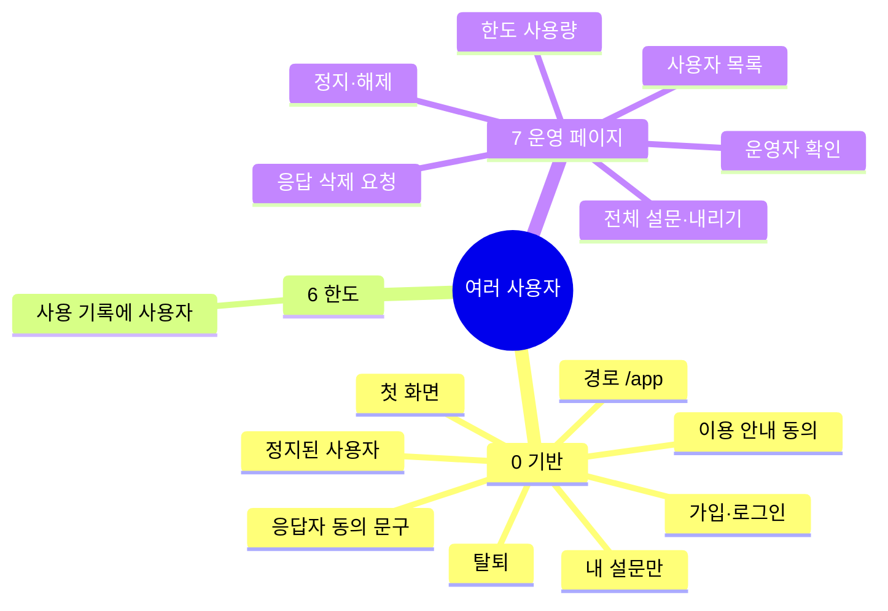
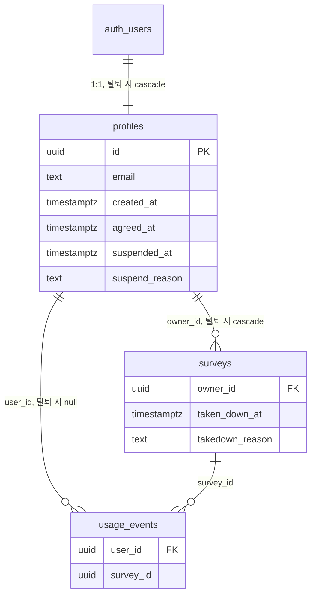

# 서베이 파일럿 여러 사용자·운영 페이지

[1인용 spec](2026-10-29-survey-pilot.md)을 바꾸는 문서다. 설문 흐름(문제 → 설계 → 문항 → 응답 → 리포트)은 그대로이고, 누가 쓰고 누가 관리하는지만 바뀐다. 1인용 spec의 R-1(관리자 로그인)·R-2(목록)·R-3(동의 문구)·R-26(응답 삭제)·R-27·R-29(사용 기록)·R-31(RLS)은 이 문서가 바꾼 대로 읽는다.

## 1. 프로젝트 기본 정보
- 이름: 서베이 파일럿 / 웹 / Next.js 16 + Supabase(무료) + Vercel Hobby / 시간은 KST로 보여 주고 UTC로 저장
- 주소: https://survey-pilot-gilt.vercel.app — 사용자 화면 `/app`, 운영 페이지 `/ops`
- 완료 기준: 운영 주소에서 두 번째 계정으로 가입 → 설문 게시 → 응답 → 리포트, 서로의 설문 접근 0건(테스트), 운영 API 전체가 일반 계정에 403(전수 테스트)
- 사람 손이 필요한 일:
  1. Supabase → Authentication → Emails → SMTP에 발송 Gmail과 앱 비밀번호 입력(사용자, 로그인 단계 전)
  2. Supabase → Authentication → Rate Limits에서 로그인 메일 시간당 30통(사용자, 같은 때)
  3. `CONTACT_EMAIL` 정해 `.env.local`·Vercel에 넣기(동의 문구 단계 전)

## 2. PRD
### 개요
누구나 이메일로 가입해 자기 설문을 만든다. 운영자(`ADMIN_EMAIL`)는 사용자 화면과 따로 된 운영 페이지에서 사용자·한도·전체 설문·응답 삭제 요청을 관리한다.

### 문제와 해결 방안
| 문제 | 해결 |
|---|---|
| `ADMIN_EMAIL` 1명만 로그인된다 | 누구나 이메일·비밀번호로 가입(메일 인증번호 확인), 설문은 `owner_id`로 나눈다 |
| Supabase 기본 로그인 메일은 시간당 약 2통 | 로그인 메일을 우리 Gmail SMTP로 |
| 운영 기능이 없다 | `/ops` — 바꾸는 조치는 미리보기 → 사유 → 실행 → 감사 기록(ADR 0012) |

### 타깃과 사용 시나리오
1. 친구가 이메일·비밀번호로 가입하고(메일 인증번호) 첫 설문을 게시한다.
2. A는 B의 설문을 목록에서도, 주소로도 볼 수 없다.
3. 운영자가 한도를 많이 쓰는 사용자를 보고 정지한다 → 그 사람의 응답 링크가 닫힌다.
4. 응답자가 `CONTACT_EMAIL`로 삭제를 요청 → 운영자가 어느 설문이든 찾아 지운다.
5. 사용자가 탈퇴 → 설문·응답이 바로 지워진다.

### 성공 지표와 위험 요소
- 지표: 위 완료 기준.
- 위험: 무료 한도(AI 하루 500회, 인증번호 메일 하루 100통)를 모두가 먼저 쓰는 사람 몫으로 함께 쓴다 — 한 사람이 다 쓰면 그날 모두 막힌다. 운영자가 사용량을 보고 정지해 대응한다.
- 위험: 아무 이메일로 가입·비밀번호 재설정 인증번호를 요청할 수 있다 — 우리 Gmail이 낯선 주소에 계속 보내면 Gmail 계정이 정지될 수 있다. 요청 횟수 제한(R-1).

### 범위 (포함 / 제외)
- 포함: R-1~R-17.
- 제외: 사람별 한도, 유료 플랜, 팀·공유 설문, Google 로그인, 운영자가 남의 설문 내용·응답 보기, 운영자가 남의 계정 지우기, 정지·내리기 메일 알림.

## 3. 기능 트리

필수 기반 기능 중 넣은 것: 첫 화면 소개·시작하기, 가입 때 이용 안내 동의, 설문 주인의 응답 삭제. 넣지 않은 것: 계정 화면(탈퇴는 목록 맨 아래 링크).

## 4. 기능 상세

### 0. 기반

- **R-1** 0.1 가입·로그인 — 누구나 이메일(아이디)과 비밀번호(8자 이상)로 가입하면, 서비스는 그 이메일로 인증번호 6자리를 보내고 맞게 넣으면 가입을 마친다(`profiles` 1행). 로그인은 이메일+비밀번호로 하고 메일을 보내지 않는다. 비밀번호를 잊으면 메일 인증번호로 새 비밀번호를 정한다. 인증번호 메일 요청(가입·재설정·다시 받기)은 같은 IP에서 시간당 5회, 같은 이메일로 1분에 1회를 넘지 않는다.
  - 권한: 누구나. 인증번호 메일은 Supabase가 Gmail SMTP로 보낸다(사람 손 1, 메일 양식에 `{{ .Token }}`).
  - 데이터: `profiles(id = auth.users.id, email, created_at)`. 요청 횟수는 IP·이메일을 `HASH_SECRET` HMAC 해시로만 센다. 비밀번호는 Supabase Auth만 가진다.
  - 화면: 로그인 / 가입 / 비밀번호 재설정. "메일로 보낸 인증번호 6자리를 넣어 주세요". 틀리면 "이메일이나 비밀번호가 맞지 않아요"(어느 쪽이 틀렸는지 알리지 않는다). 넘으면 "잠시 후 다시 시도해 주세요".
  - 확인: 인증번호로 가입을 마치면 로그인되고 profiles 1행, 인증 전 로그인 거부, 비밀번호 8자 미만 거부, 같은 IP 6번째 인증번호 요청 거부, 재설정 인증번호로 새 비밀번호 로그인.
- **R-2** 0.2 이용 안내 동의 — 처음 로그인한 사용자가 동의하기 전에는, 서비스는 설문 만들기·AI·게시를 거부한다.
  - 안내: 무료 한도를 모든 사용자가 함께 쓴다, 응답자 개인정보는 설문을 만든 사람이 책임진다, 운영자는 가입 이메일과 설문 목록·숫자를 본다(내용·응답은 보지 않는다).
  - 데이터: `profiles.agreed_at`.
  - 확인: 동의 전 세션으로 만들기 API 호출 시 403.
- **R-3** 0.3 내 설문만 — 로그인한 사용자가 설문을 열거나 바꾸면, 서비스는 `owner_id = 본인`일 때만 처리한다. 남의 설문 주소는 404.
  - 서버(모든 화면·액션·CSV·리포트)와 RLS(`owner_id = auth.uid()`) 두 곳에서 막는다. RLS에서 `ADMIN_EMAIL` 조건은 뺀다(ADR 0019 v2).
  - 확인: A 세션으로 B의 설문 조회·수정·CSV·리포트 요청 → 0행 또는 404.
- **R-4** 0.4 응답자 동의 문구 — 응답 화면 동의 안내에 "응답은 설문을 만든 사람이 봅니다. 운영자는 응답 수만 봅니다"와 삭제 요청 연락처(`CONTACT_EMAIL`)를 넣는다.
  - 확인: 응답 화면 문구 테스트.
- **R-5** 0.5 첫 화면 — `/`는 서비스 소개 3줄과 "시작하기"(로그인)를 보여 준다. 로그인한 상태면 `/app`으로 보낸다.
  - 확인: 로그인 전 `/` 200·"시작하기", 로그인 뒤 `/` → `/app`.
- **R-6** 0.6 경로 — 사용자 화면은 `/app`, 운영 페이지는 `/ops`. 지금의 `/admin` 주소는 같은 아래 경로의 `/app`으로 보낸다.
  - 확인: `/admin/surveys/<id>` → `/app/surveys/<id>`.
- **R-7** 0.7 탈퇴 — 사용자가 탈퇴하면, 서비스는 미리보기(지워질 설문 n개·응답 m개) → 확인 글자 → 즉시 삭제(Auth 사용자·profiles·설문과 그 아래 전부) → 감사 기록 순서로 처리한다. 운영자 계정은 탈퇴할 수 없다.
  - 화면: 내 설문 목록 맨 아래 "탈퇴하기" 링크. 진행 중 설문도 바로 지워져 링크가 404가 된다고 미리보기에 적는다. CSV를 먼저 받으라고 안내.
  - 데이터: `surveys.owner_id → profiles on delete cascade`, `usage_events.user_id → on delete set null`. 감사 기록은 내부 번호만.
  - 확인: 탈퇴 뒤 그 사용자의 surveys·responses·respondents 0행, usage_events.user_id null, audit_logs 1행.
- **R-8** 0.8 정지된 사용자 — `profiles.suspended_at`이 있으면, 서비스는 그 사용자의 만들기·AI·게시·수정을 거부하고, 그 사용자의 설문 응답 링크는 "지금은 응답을 받지 않아요"를 보여 주며 인증번호 발송·제출을 거부한다. 해제되면 다시 열린다.
  - 화면: 로그인하면 "이용이 정지됐어요" 안내(사유는 보이지 않는다). 메일로 알리지 않는다.
  - 확인: 정지 계정의 만들기·AI 403, 정지 사용자의 설문 제출 거부, 해제 뒤 제출 성공.

### 6. 한도

- **R-9** 6.1 사용 기록에 사용자 — AI 호출과 메일 발송을 기록할 때, 서비스는 `usage_events.user_id`(설문 주인)와 `survey_id`를 채운다. 한도 계산은 지금처럼 전체 합(사람별 한도 없음).
  - 확인: 설문에서 AI를 부른 뒤 그 행에 user_id·survey_id가 있다.

### 7. 운영 페이지

- **R-10** 7.1 운영자 확인 — `/ops` 아래 모든 화면·액션은, 로그인 이메일이 `admins` 테이블(`ADMIN_EMAIL`)에 있을 때만 처리한다. 확인은 경로 단위 한 곳에서 걸고 전수 테스트로 지킨다(ADR 0012).
  - 운영자도 자기 설문은 `/app`에서 일반 사용자와 똑같이 쓴다.
  - 확인: 운영 액션 전체를 일반 계정으로 부르면 403.
- **R-11** 7.2 사용자 목록 — 운영자가 열면, 서비스는 사용자마다 이메일·가입일·마지막 로그인·설문 수·최근 24시간 AI 사용·정지 여부를 가입일 최신순으로 보여 준다.
  - 마지막 로그인은 `auth.users.last_sign_in_at`. 비었을 때 "아직 가입한 사람이 없어요".
  - 확인: 목록 수 = profiles 수.
- **R-12** 7.3 정지·해제 — 운영자가 정지하면, 서비스는 미리보기(닫힐 응답 링크 수) → 사유 → 실행 → 감사 기록으로 `suspended_at`·`suspend_reason`을 쓴다. 해제도 같은 틀. 운영자 자신은 정지할 수 없다.
  - 확인: 정지 실행 시 audit_logs 1행, 자기 자신 정지 거부.
- **R-13** 7.4 한도 사용량 — 운영자가 열면, 서비스는 최근 24시간 AI·메일 사용량 / 한도와 사용자별 사용량 순위를 보여 준다.
  - 확인: 화면 숫자 = usage_events 집계.
- **R-14** 7.5 전체 설문과 내리기 — 운영자가 열면, 서비스는 모든 설문의 문제 제목·소유자 이메일·상태·응답 수만 보여 준다(문항·답·리포트는 고르지도 않는다). 운영자가 내리면 미리보기 → 사유 → 실행 → 감사 기록으로 `taken_down_at`을 쓰고, 응답 링크는 "지금은 응답을 받지 않아요". 되돌리기는 운영자만.
  - 주인 화면: "운영자가 내린 설문이에요" 표시, 주인은 되돌릴 수 없다. 주인의 보관함(`archived_at`)과는 별개.
  - 확인: 운영 목록 응답에 문항·답 필드 없음, 내린 설문 제출 거부, 주인의 되돌리기 거부.
- **R-15** 7.6 응답 삭제 요청(운영자) — 운영자가 이메일로 찾으면, 서비스는 그 이메일이 응답한 설문 제목·응답 수만 미리 보여 주고 → 사유 → 삭제 → 감사 기록. 모든 사용자의 설문이 대상.
  - 확인: 다른 사용자 설문의 응답이 지워지고 audit_logs 1행.
- **R-16** 7.7 응답 삭제 요청(설문 주인) — 설문 주인은 지금 R-26처럼 자기 설문에서만 응답 삭제를 처리한다.
  - 확인: 남의 설문 응답 삭제 시도 거부.
- **R-17** 7.8 기존 데이터 이전 — 마이그레이션은 이미 있는 Auth 사용자마다 profiles를 만들고(운영자는 동의한 것으로), 기존 설문은 지금 소유자(운영자) 그대로 둔다.
  - 확인: 마이그레이션 전후 surveys·responses 건수가 같고 모든 surveys.owner_id에 profiles 행이 있다.

## 5. 데이터 모델

| 대상 | 바뀌는 것 |
|---|---|
| `profiles`(새로) | 처음 로그인 때 서버가 만든다. 마지막 로그인은 저장하지 않고 `auth.users`에서 읽는다 |
| `surveys` | `owner_id` → profiles(cascade), `taken_down_at`·`takedown_reason` |
| `usage_events` | `user_id`(set null), `survey_id` 채움 |
| `login_attempts`(새로) | 인증번호 메일 요청 횟수(IP·이메일 해시, 시각) — 서버만 |
| `admins`·`audit_logs` | 그대로. 감사 조치 종류만 늘어난다(정지·해제·내리기·되돌리기·탈퇴·응답 삭제) |

행 단위 권한(ADR 0019 v2): surveys와 하위 행은 `owner_id = auth.uid()`만 읽는다. profiles는 자기 행만 읽는다. 쓰기와 운영 페이지 읽기는 서버(service role)가 운영자 확인 뒤에 한다 — 운영자에게도 RLS로 남의 행을 열지 않는다. anon은 여전히 정책 없음.

## 6. 화면 목록
| 화면 | 관련 기능 | 주요 요소 |
|---|---|---|
| `/` 첫 화면 | R-5 | 소개 3줄, 시작하기 |
| `/login` | R-1 | 로그인(이메일·비밀번호), 가입, 인증번호, 비밀번호 재설정, 횟수 초과 안내 |
| `/app` 이용 안내 | R-2 | 안내 3가지, 동의하고 시작 |
| `/app` 내 설문 | R-3, R-7, R-8 | 지금 목록 그대로 + 맨 아래 탈퇴하기, 정지 안내 |
| `/app/leave` 탈퇴 | R-7 | 지워질 것 미리보기, 확인 글자 |
| `/ops` 개요 | R-10, R-13 | 오늘 AI·메일 사용량 / 한도, 사용자별 순위 |
| `/ops/users` | R-11, R-12 | 사용자 표, 정지·해제 |
| `/ops/surveys` | R-14 | 전체 설문 표, 내리기·되돌리기 |
| `/ops/deletion` | R-15 | 이메일로 찾기 → 미리보기 → 사유 → 삭제 |
| `/s/<slug>` | R-4, R-8, R-14 | 동의 문구, 닫힌 링크 안내 |

화면 디자인은 `/intaeng:디자인`으로 하고 apple-design 스킬을 쓴다(사용자 요청, 들일 때 skills.md·ADR).

## 7. 결정 사항
| 질문 | 결정 | 이유 | 출처 |
|---|---|---|---|
| 누가 쓰나 | 누구나 이메일로 가입 | 다른 사람도 쓰게 | 사용자 답 2026-10-30 |
| 한도 나누기 | 사람별 제한 없이 먼저 쓰는 사람 몫 | 단순하게 | 사용자 답 |
| 관리자 페이지 | 사용자 화면과 따로(`/ops`) | 관리할 수 있게 | 사용자 답 |
| 로그인 방식 | 이메일(아이디)+비밀번호, 가입·재설정은 메일 인증번호 6자리(v2, 이전: 이메일 링크) | 메일은 가입·재설정 때만 나가 Gmail 한도를 덜 쓴다 | 사용자 답(2026-10-30 "로그인이 아이디 비번으로, 가입할 때 인증번호를 메일로") |
| 운영 관리 범위 | 사용자 목록·정지, 한도 사용량, 전체 설문 목록, 응답 삭제 요청 | | 사용자 답 |
| 운영자 열람 | 목록·숫자만 | 개인정보 최소 | 사용자 답 |
| 탈퇴 | 바로 모두 삭제 | | 사용자 답 |
| 필수 기반 기능 | 첫 화면, 이용 안내 동의, 주인의 응답 삭제. 계정 화면은 뺌 | | 사용자 답 |
| 정지 때 설문 | 응답 링크 닫기 | 스팸 설문을 바로 멈춤 | 사용자 답 |
| 운영자가 내린 설문 | 운영자만 되돌림 | | 사용자 답 |
| 탈퇴 위치 | 내 설문 목록 맨 아래 링크 | | 사용자 답 |
| 운영자에게 이메일 | 전체 표시, 이용 안내에 명시 | 정지 대상 확인 | 사용자 답 |
| 로그인 요청 남용 | IP 시간당 5회·이메일 1분 1회 | R-4와 같은 방식 | 사용자 답 |
| 정지·내리기 알림 | 화면 안내만(메일 없음) | Gmail 한도 아끼기 | 가정 1, 사용자 확인 |
| 경로 | 사용자 `/app`, 운영 `/ops` | | 가정 2, 사용자 확인 |
| 디자인 | apple-design 스킬 | | 사용자 요청 |
| 응답자 쪽 접근 | 서버로만 그대로 | | ADR 0019 |
| 관리 조치 틀 | 미리보기 → 사유 → 실행 → 감사 기록 | | ADR 0012 |
| 운영자 계정 | 탈퇴·정지 불가 | 운영자가 없어지면 관리가 멈춤 | Claude 기본값 |
| 로그인 메일 시간당 한도 | Supabase 설정 30통 | Gmail 계정 보호 | Claude 기본값 |

## 8. 미결 사항 / 추가 제안
- `CONTACT_EMAIL` 값(사람 손 3).
- 추가 제안(이번 범위 밖): 사람별 하루 한도, 운영자에게 한도 80% 알림, Google 로그인.
